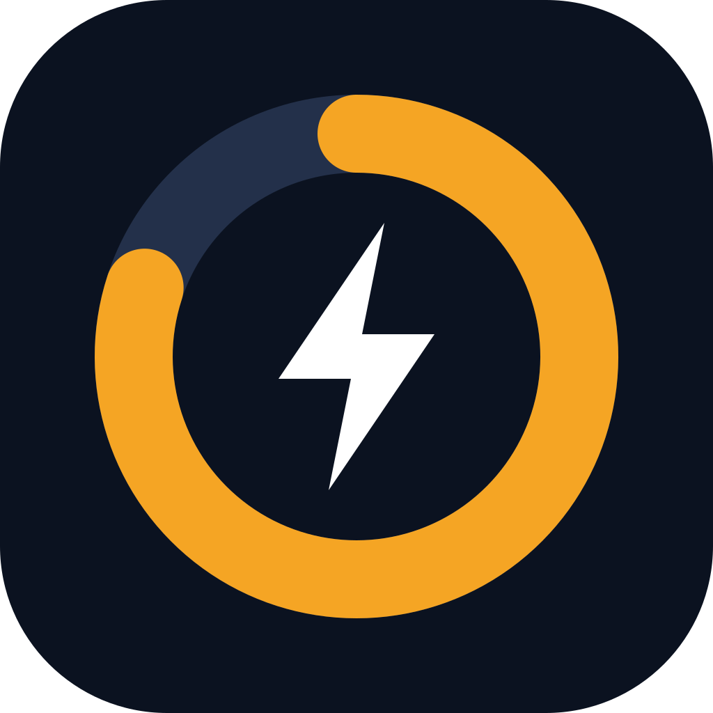
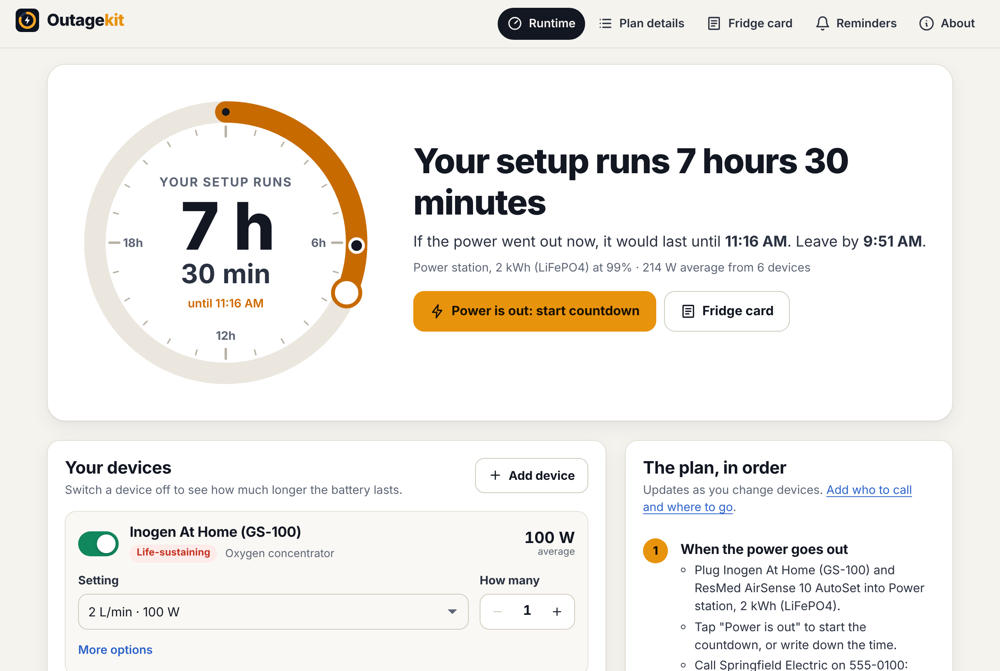
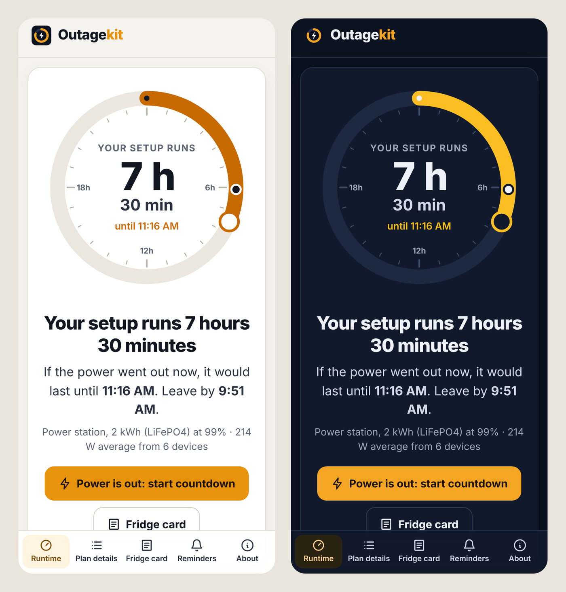
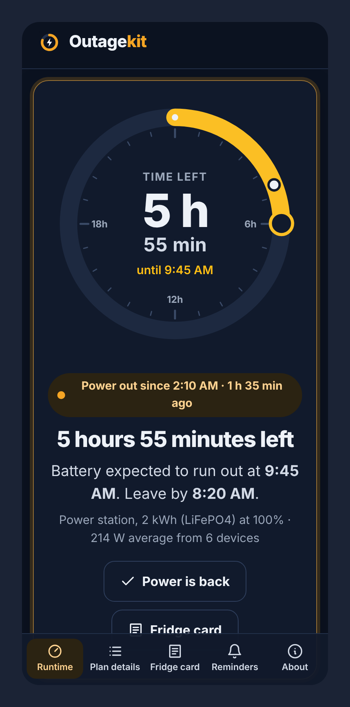
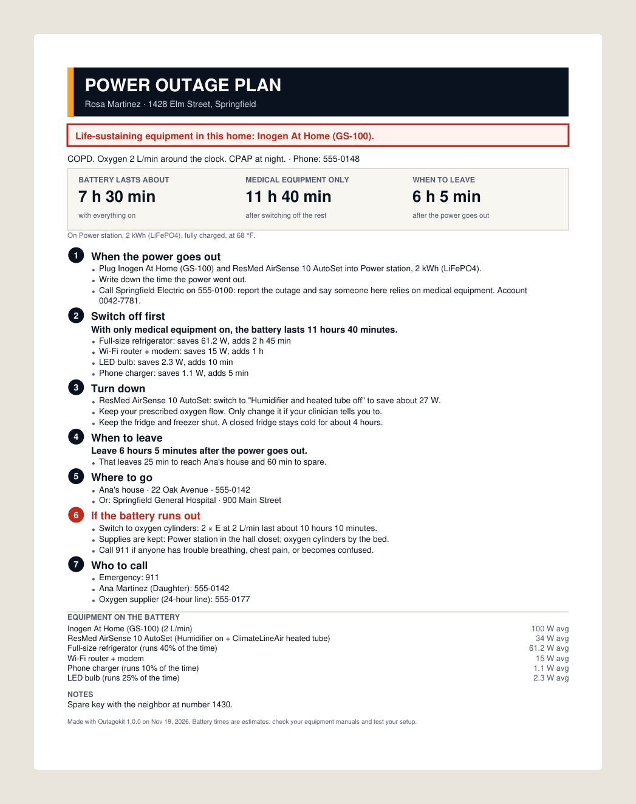
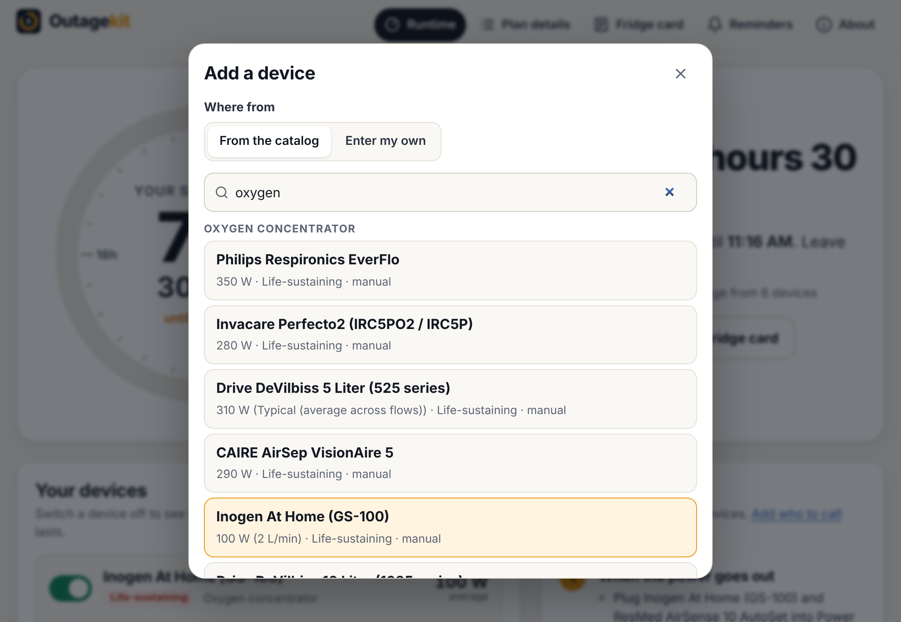

<div align="center">



# Outagekit

**How long will your battery run your oxygen, CPAP or ventilator?**
<br />
An offline runtime calculator and one-page outage plan for people who depend on electric medical equipment.

[](https://github.com/lobojoel2003/Outagekit/actions/workflows/ci.yml)
[](https://github.com/lobojoel2003/Outagekit/releases/latest)
[](https://lobojoel2003.github.io/Outagekit/)
[](LICENSE)
[](packages/runtime/LICENSE)

[**Open the web app**](https://lobojoel2003.github.io/Outagekit/) ·
[**Download for Android**](https://github.com/lobojoel2003/Outagekit/releases/latest) ·
[How the math works](docs/METHOD.md) ·
[Device catalog](docs/catalog.md)



</div>

## Why

For someone on an oxygen concentrator, ventilator, CPAP or powered bed, a power
cut is a medical emergency with a countdown. Most families do not know how long
their battery will last, or what to do when it runs out.

- "Millions of Medicare beneficiaries rely on electricity-dependent durable
  medical and assistive equipment," and long outages "can be life-threatening
  for these individuals" ([HHS emPOWER](https://empowerprogram.hhs.gov/about-empowermap.html)).
- The federal emPOWER program tracks users of 14 kinds of electric medical
  device, and Los Angeles County used that data more than a dozen times for
  wildfires and planned power shutoffs
  ([ASTHO](https://www.astho.org/topic/brief/leveraging-the-hhs-empower-program-to-enhance-power-outage-planning)).
  That data goes to emergency planners, not to the families themselves.

What exists today is advice pages and checklists, and blogs from battery
sellers who want you to buy theirs. There was no neutral calculator. Outagekit
is one, and it is free and open source.

## What it does

|                         |                                                                                                                                                                |
| ----------------------- | -------------------------------------------------------------------------------------------------------------------------------------------------------------- |
| **One dial**            | "Your setup runs 7 hours 20 minutes." Change a device setting or the battery and it moves at once, with the clock time it would run out.                       |
| **The plan, in order**  | What to switch off first and how much time each step buys, what to turn down, when to leave, where to go, what to do when the battery runs out, who to call.   |
| **Outage mode**         | Tap "Power is out" for a live countdown. Switching things off mid-outage stretches what is left; you can correct it from the charge on your battery's display. |
| **Fridge card**         | A one-page PDF in large type, made on your device, for a stressed neighbor or a first responder.                                                               |
| **Keep it charged**     | Estimates how much charge a stored battery has lost, reminds you to top it up (Android notifications or a repeating calendar event).                           |
| **Open catalog**        | Common oxygen concentrators, CPAPs, ventilators, beds, pumps and power stations, with sources from manufacturer manuals.                                       |
| **Offline and private** | Works with no power and no internet once opened. Everything stays on your device.                                                                              |

## Screenshots

<table>
  <tr>
    <td width="33%"></td>
    <td width="33%"></td>
    <td width="33%"></td>
  </tr>
  <tr>
    <td align="center">Runtime on a phone, light and dark</td>
    <td align="center">Outage mode countdown</td>
    <td align="center">The fridge card (PDF)</td>
  </tr>
</table>

<p align="center">
  <a href="docs/images/sample-fridge-card.pdf">Open a sample fridge card (PDF)</a>, made with fictional details.
</p>

<p align="center">
  
</p>

## Get it

- **Web app:** <https://lobojoel2003.github.io/Outagekit/>. Open it once while
  online, then use your browser's "Install" or "Add to Home screen". It keeps
  working with no internet.
- **Android:** download the APK from the
  [latest release](https://github.com/lobojoel2003/Outagekit/releases/latest).
  The Android app adds reliable reminders that fire even when the app is closed.
- **Host it yourself:** each release includes `outagekit-web-<version>.zip`,
  static files that run from any folder on any web server.

## How the runtime is worked out

```
average draw   = running watts × share of time running (+ standby), for each device
battery draw   = inverter's own use + AC devices ÷ inverter efficiency + DC devices ÷ DC efficiency
usable energy  = capacity × charge × usable share × health (age, cycles) × cold derating × lead-acid high-draw loss
runtime        = usable energy ÷ battery draw, rounded down
```

Every factor, default and assumption is written up in
[docs/METHOD.md](docs/METHOD.md), and you can open "How this is worked out"
under any battery in the app to see the numbers for your own setup.

## The runtime library (MIT)

The math and the catalog are a separate, dependency-free TypeScript library,
[`@outagekit/runtime`](packages/runtime), so utilities, clinics, emergency
planners and other apps can use them.

```ts
import { estimateRuntime, formatDuration } from '@outagekit/runtime';

const { hours, warnings } = estimateRuntime(
  [{ id: 'o2', name: 'Oxygen concentrator', watts: 300, priority: 'life-sustaining' }],
  { id: 'ps', name: 'Power station', capacityWh: 1024, chemistry: 'lifepo4' },
);
formatDuration(hours); // "2 hours 50 minutes"
```

## The device catalog

An open JSON catalog of home medical devices, household essentials and power
stations, with each figure's source. See the readable
[catalog listing](docs/catalog.md), the
[JSON files](packages/runtime/src/catalog) and their
[schemas](packages/runtime/schema). Corrections backed by a manufacturer's
manual are very welcome:
[suggest one](https://github.com/lobojoel2003/Outagekit/issues/new?template=catalog.yml).

## Development

Requires Node.js 22.12+ and pnpm 10 (`corepack enable`).

```bash
pnpm install
pnpm dev          # http://localhost:5173
pnpm check        # lint, formatting, types and unit tests
pnpm build && pnpm e2e
```

| Path                                   | What                                                                | License |
| -------------------------------------- | ------------------------------------------------------------------- | ------- |
| [`packages/runtime`](packages/runtime) | Runtime math, catalog, schemas, tests                               | MIT     |
| [`apps/web`](apps/web)                 | React app, installable and offline (Vite, vite-plugin-pwa, pdf-lib) | GPL-3.0 |
| [`apps/web/android`](apps/web/android) | Capacitor Android app with local notifications                      | GPL-3.0 |
| [`docs`](docs)                         | Method, catalog listing, release guide                              |         |

Build the Android app with `pnpm --filter @outagekit/web android:debug`
(needs the Android SDK and JDK 21). See [CONTRIBUTING.md](CONTRIBUTING.md).

## Releases, versions and builds

The web app, Android app and library share one [semantic version](https://semver.org/).
Pushing a tag such as `v1.0.0` runs the
[release workflow](.github/workflows/release.yml), which tests everything and
publishes a GitHub release with the Android APK, a self-hostable web build,
the library tarball, the catalog JSON and checksums. Android's `versionCode`
is `major × 10000 + minor × 100 + patch`; the CI run number is the build
number, shown in the app under About. Details are in
[docs/RELEASING.md](docs/RELEASING.md) and changes in
[CHANGELOG.md](CHANGELOG.md).

| Workflow                                      | Runs on                     | Does                                                                                                                   |
| --------------------------------------------- | --------------------------- | ---------------------------------------------------------------------------------------------------------------------- |
| [CI](.github/workflows/ci.yml)                | every push and pull request | lint, format, types, unit tests with coverage, Playwright on desktop and mobile (including offline), Android debug APK |
| [Deploy web app](.github/workflows/pages.yml) | push to `main`              | builds and publishes to GitHub Pages                                                                                   |
| [Release](.github/workflows/release.yml)      | tags `v*.*.*`               | verifies the tag, builds and publishes the release (and the library to npm when configured)                            |
| [CodeQL](.github/workflows/codeql.yml)        | `main` and weekly           | security analysis                                                                                                      |

## Please read

Outagekit gives **estimates** to help you plan. It is not medical advice and
not a guarantee: devices draw more at higher settings, when starting up, and
when batteries are old or cold. Test your own setup, never change a prescribed
setting to save power without your clinician, register with your electric
utility's medical program, and in an emergency call 911.

## License

- The Outagekit app is free software under the
  [GNU General Public License v3.0](LICENSE).
- The [`@outagekit/runtime`](packages/runtime) library and the device catalog
  are under the [MIT License](packages/runtime/LICENSE).

Copyright © 2026 Joel Stain Lobo and Outagekit contributors.
